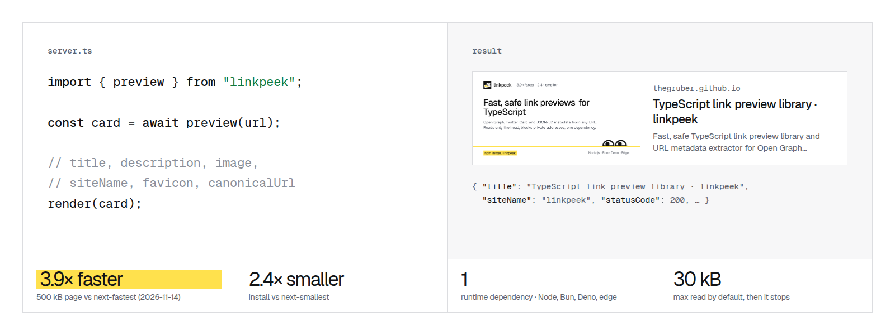

<p align="center">
  <a href="https://linkpeek.js.org/"></a>
</p>

<h1 align="center">linkpeek</h1>

<p align="center">
  <a href="https://www.npmjs.com/package/linkpeek"></a>
  <a href="https://www.npmjs.com/package/linkpeek"></a>
  <a href="https://github.com/thegruber/linkpeek/actions/workflows/ci.yml"></a>
  <a href="https://packagephobia.com/result?p=linkpeek"></a>
</p>


<p align="center"><a href="https://linkpeek.js.org/">Website</a> · <a href="https://linkpeek.js.org/quick-start/">Quick start</a> · <a href="https://linkpeek.js.org/api/">API</a> · <a href="https://linkpeek.js.org/benchmarks/">Benchmarks</a> · <a href="https://github.com/thegruber/linkpeek/tree/main/examples">Examples</a> · <a href="https://github.com/thegruber/linkpeek/blob/main/CHANGELOG.md">Changelog</a></p>

Paste a link into Slack and you get a card with a title, a description and an image. linkpeek is a TypeScript library for building those link previews (unfurling, in Slack's words). Give it a URL and it fetches the page, reads the Open Graph, Twitter Card and JSON-LD tags, and hands you one typed object. It works in Node.js, Bun, Deno and Cloudflare Workers.

Most pages keep all of that in `<head>`, so linkpeek stops reading there and drops the rest of the download. That's why it's fast on big pages, and why it gets by with one dependency.

```bash
npm install linkpeek
```

```typescript
import { preview } from "linkpeek";

const result = await preview("https://github.com");

result.title;        // "GitHub · Change is constant. GitHub keeps you ahead. · GitHub"
result.description;  // "Join the world's most widely adopted…"
result.image;        // "https://images.ctfassets.net/8aevphvgewt8/…/OG_image.jpg"
result.siteName;     // "GitHub"
result.favicon;      // "https://github.githubassets.com/favicons/favicon.svg"
```

Needs Node.js 22.12 or newer. On Deno: `deno add jsr:@thegruber/linkpeek` ([JSR](https://jsr.io/@thegruber/linkpeek)) or `import { preview } from "npm:linkpeek"`. CI runs Node 22, 24 and 26, Bun and Deno.

<p align="center"><a href="https://linkpeek.js.org/"></a></p>

## How it compares

I measured linkpeek against the five other link preview and Open Graph packages on npm, with the same pages served from a local server, so only library time counts (15 November 2026, Linux x64, Node.js 24.22, median of three runs):

| Package | 500 kB page | Small pages (0.6–2.3 kB) | Clean install |
| --- | ---: | ---: | ---: |
| **linkpeek** | **2.76 ms** | 1.25 ms | **1.3 MB, 7 packages** |
| unfurl.js 6.4.0 | 11.0 ms | 0.80 ms | 3.2 MB, 16 packages |
| link-preview-js 6.0.0 | 48.6 ms | 1.72 ms | 7.9 MB, 18 packages |
| url-metadata 6.3.1 | 49.5 ms | 2.89 ms | 10.4 MB, 30 packages |
| metascraper 5.58.6 (+7 rules) | 62.6 ms | 2.71 ms | 81.1 MB, 128 packages |
| open-graph-scraper 6.13.0 | 377 ms | 1.94 ms | 11.1 MB, 27 packages |

On small pages unfurl.js wins by about half a millisecond. It talks to Node's `http` module directly, while linkpeek uses the standard `fetch` so the same code runs on Workers and Deno. Of the packages that use `fetch`, linkpeek was fastest on every page. The [benchmark page](https://linkpeek.js.org/benchmarks/) has the charts and method, and the [comparison notes](https://github.com/thegruber/linkpeek/blob/main/docs/comparison.md) have every dated run and the commands to reproduce them.

Pick something else if you need article text (metascraper), parsing the first URL out of a chat message (link-preview-js), or oEmbed responses fetched for you (unfurl.js). linkpeek finds the oEmbed endpoint but leaves the fetch to you. Migration notes: [link-preview-js](https://linkpeek.js.org/guides/link-preview-js-alternative/) · [open-graph-scraper](https://linkpeek.js.org/guides/open-graph-scraper-alternative/) · [unfurl.js](https://linkpeek.js.org/guides/unfurl-js-alternative/) · [url-metadata](https://linkpeek.js.org/guides/url-metadata-alternative/) · [metascraper](https://linkpeek.js.org/guides/metascraper-alternative/).

## Use it on a server

Browsers won't let a page read other sites (CORS), so link previews are always built server-side. Slack and Discord do it the same way. Put `preview()` behind a route and send the card data to your frontend:

```typescript
// app/api/preview/route.ts (Next.js App Router)
import { preview } from "linkpeek";
import { type NextRequest, NextResponse } from "next/server";

export async function GET(req: NextRequest) {
  const url = req.nextUrl.searchParams.get("url");
  if (!url) return NextResponse.json({ error: "Missing url" }, { status: 400 });

  try {
    return NextResponse.json(await preview(url));
  } catch (err) {
    return NextResponse.json(
      { error: err instanceof Error ? err.message : "Preview failed" },
      { status: 422 },
    );
  }
}
```

The same thing for [Express](https://linkpeek.js.org/integrations/node-express/), [Cloudflare Workers](https://linkpeek.js.org/integrations/cloudflare-workers/), [Bun and Supabase Edge Functions](https://github.com/thegruber/linkpeek/tree/main/examples), plus a [React card component](https://linkpeek.js.org/integrations/react/). There's also a guide on [getting the og:image from a URL](https://linkpeek.js.org/guides/get-og-image-from-url/), and one on [using it in AI agent tools](https://linkpeek.js.org/integrations/ai-agents/). `parseHTML()` makes no requests, so it also works in the browser when you already have the HTML.

Using a coding agent? Paste the [agent task](https://linkpeek.js.org/prompt.md) into Claude Code, Cursor, Codex or Copilot and it adds the endpoint and the card for you.

## Fast or thorough

The default reads at most 30 kB and stops at `</head>`. Some pages put their JSON-LD or their only image in the body, or send you through a `<meta refresh>` first. `presets.quality` handles those, at the cost of reading up to 200 kB:

```typescript
import { preview, presets } from "linkpeek";

await preview(url);                                       // fast: 30 kB, head only
await preview(url, presets.quality);                      // 200 kB, body fallbacks, meta refresh
await preview(url, { ...presets.quality, timeout: 3000 }); // presets are plain objects
```

## Errors

A 404 or 500 page that returns HTML doesn't throw. You get whatever metadata it had plus its `statusCode`, so check that before you cache or show it:

```typescript
const result = await preview(url);
if (result.statusCode >= 400) {
  // show a plain link instead, don't cache
}
```

Everything else throws a `LinkpeekError` with a `code` you can switch on:

```typescript
import { LinkpeekError, preview } from "linkpeek";

try {
  await preview(url);
} catch (err) {
  if (err instanceof LinkpeekError) {
    switch (err.code) {
      case "INVALID_URL":              // unparseable, or has user:password@
      case "UNSUPPORTED_PROTOCOL":     // not http or https
      case "PRIVATE_NETWORK_BLOCKED":  // points at a private or internal address
      case "SENSITIVE_HEADER":         // you passed a credential header
      case "TOO_MANY_REDIRECTS":
      case "TIMEOUT":                  // the whole call took too long
      case "FETCH_FAILED":             // network, DNS or resolveHost failure; see err.cause
      case "INVALID_OPTIONS":
        break;
    }
  }
  // If you abort with your own `signal`, your abort reason is rethrown unchanged.
}
```

A URL that points straight at an image, video or audio file comes back as `image`, `video` (with `videoType`) or `audio`, with `mediaType` set to match.

## Security

A preview endpoint fetches whatever URL a user sends it. Without checks, someone can point it at `http://169.254.169.254/` and read your cloud credentials. That attack is called server-side request forgery (SSRF), so linkpeek checks the URL and every redirect before it follows them. It refuses:
- private, loopback, link-local and cloud-metadata IPs, in any spelling (`127.1`, `0x7f000001` and IPv6 forms included);
- internal names like `localhost`, `*.internal` and `*.local`;
- URLs with credentials in them, and credential headers you might pass by mistake.

It does not pin DNS. A public hostname can still resolve to a private address when `fetch` connects. On Node.js, add `resolveHost` to check each hop's DNS answers too:

```typescript
import { lookup } from "node:dns/promises";

await preview(url, {
  resolveHost: async (host) =>
    (await lookup(host, { all: true })).map((entry) => entry.address),
});
```

That narrows DNS rebinding but doesn't close it, because `fetch` resolves the name again. If you preview URLs from untrusted users, also block outbound traffic to internal networks at the network level. The [security page](https://linkpeek.js.org/security/) covers the details and a production checklist. Treat everything a page returns as untrusted text.

## API

### `preview(url, options?)`

Fetches the URL and returns `Promise<PreviewResult>`.

#### Options

| Option | Type | Default | Description |
| --- | --- | --- | --- |
| `timeout` | `number` | `8000` | Deadline in milliseconds for the whole call (redirects, body read and any meta-refresh hop), from 0 to 2,147,483,647. Throws `LinkpeekError` code `TIMEOUT` when elapsed; invalid values throw `INVALID_OPTIONS` |
| `maxBytes` | `number` | `30_000` | Maximum decoded response-body bytes to retain. `result.truncated` reports when the limit cut the head (or the document, with `includeBodyContent`) |
| `userAgent` | `string` | `"Twitterbot/1.0"` | User-Agent sent with requests |
| `followRedirects` | `boolean` | `true` | Follow HTTP redirects after validating each target |
| `maxRedirects` | `number` | `10` | Maximum redirects per call, HTTP and meta refresh combined. Must be a non-negative integer; invalid values throw `INVALID_OPTIONS` |
| `headers` | `Record<string, string>` | `{}` | Extra non-sensitive request headers. Common credential-bearing headers are rejected; custom headers are not forwarded on cross-origin redirects |
| `allowPrivateIPs` | `boolean` | `false` | Allow private/internal IP targets |
| `resolveHost` | `(hostname) => Promise<string[]>` | none | Opt-in DNS check on the first request and every redirect hop; any private answer throws `PRIVATE_NETWORK_BLOCKED`, a lookup error or empty answer throws `FETCH_FAILED` (a `LinkpeekError`, resolver error in `cause`) |
| `signal` | `AbortSignal` | none | Cancel the request from the caller side |
| `fetch` | `typeof fetch` | `globalThis.fetch` | Custom fetch implementation. It must honor manual redirects and the supplied abort signal; a `response.url` it reports is validated too |
| `followMetaRefresh` | `boolean` | `false` | Follow one `<head>` `<meta http-equiv="refresh">` redirect with a delay of 10s or less |
| `includeBodyContent` | `boolean` | `false` | Continue scanning `<body>` for JSON-LD and image fallbacks |

#### Result fields

| Field | Type | Description |
| --- | --- | --- |
| `url` | `string` | Final fetched URL; `parseHTML()` returns the canonical URL |
| `statusCode` | `number` | HTTP status code. `parseHTML()` returns `0` |
| `title` | `string \| null` | `og:title` -> `twitter:title` -> Dublin Core -> `<title>` -> JSON-LD headline/name of the page's main entity |
| `description` | `string \| null` | `og:description` -> `twitter:description` -> `meta[name=description]` -> JSON-LD -> Dublin Core |
| `image` | `string \| null` | Preview image URL |
| `imageAlt` | `string \| null` | Image alt text |
| `imageWidth` | `number \| null` | `og:image:width` |
| `imageHeight` | `number \| null` | `og:image:height` |
| `siteName` | `string` | `og:site_name` -> JSON-LD publisher -> JSON-LD `WebSite` name -> hostname |
| `favicon` | `string \| null` | Declared favicon, or the origin’s `/favicon.ico` as a fallback guess |
| `mediaType` | `string` | `og:type`, defaults to `"website"` |
| `canonicalUrl` | `string` | Canonical URL, `og:url`, or fetched URL |
| `author` | `string \| null` | JSON-LD author, author meta, or Dublin Core creator |
| `locale` | `string \| null` | `og:locale` |
| `lang` | `string \| null` | HTML language, content-language, or locale prefix |
| `publishedDate` | `string \| null` | Article, JSON-LD, or Dublin Core date |
| `keywords` | `string[] \| null` | `meta[name=keywords]` |
| `video` | `string \| null` | Safe `og:video` URL |
| `videoType` | `string \| null` | `og:video:type` MIME type, or the content type of a direct video URL; `null` without a video |
| `audio` | `string \| null` | Safe `og:audio` URL |
| `twitterCard` | `string \| null` | Twitter card type |
| `twitterSite` | `string \| null` | Twitter site handle |
| `twitterCreator` | `string \| null` | Twitter creator handle |
| `twitterPlayer` | `string \| null` | `twitter:player` embed URL (an iframe page), http(s) only |
| `twitterPlayerStream` | `string \| null` | `twitter:player:stream` raw media URL, http(s) only |
| `themeColor` | `string \| null` | Theme color |
| `oEmbedUrl` | `string \| null` | Discovered oEmbed endpoint URL. Not fetched |
| `truncated` | `boolean` | `maxBytes` cut the response before the end of `<head>` (or the document, with `includeBodyContent`). `parseHTML()` returns `false` |

Text fields are trimmed and blank values count as missing. JSON-LD fields come from the page's own entity (its article, product and so on), never from a site-wide `Organization` or `WebSite` block.

### `parseHTML(html, baseUrl, options?)`

The same extraction for HTML you already have, with no network request. `baseUrl` resolves relative links and must be an absolute `http(s)` URL, otherwise it throws `INVALID_URL`. Pass `{ includeBodyContent: true }` to keep reading past `<head>`.

```typescript
import { parseHTML } from "linkpeek";

parseHTML("<title>Hello</title>", "https://example.com").title; // "Hello"
```

### `validateUrl(url, allowPrivateIPs?)` and `isPrivateHost(hostname)`

The checks `preview()` uses, exported so you can reject a URL before queueing a job. `validateUrl` throws a `LinkpeekError`, and `isPrivateHost` returns a boolean.

```typescript
import { validateUrl } from "linkpeek";

validateUrl("http://169.254.169.254/"); // throws PRIVATE_NETWORK_BLOCKED
```

## FAQ

**A site returns 403 or no metadata.** Some sites block server-side requests with bot checks or rate limits. linkpeek doesn't run browser challenges. Cache what works and fall back to the hostname. There's more in [troubleshooting](https://linkpeek.js.org/guides/troubleshooting/).

**`title` is `null` on a single-page app.** That page sets its tags with JavaScript, and linkpeek doesn't run a browser. `presets.quality` picks up JSON-LD that many SPAs ship in the body. Past that you need a headless browser.

**I got a card for a 404.** See [Errors](#errors): check `statusCode`.

## Contributing

Questions and ideas go in [Discussions](https://github.com/thegruber/linkpeek/discussions), and bugs or wrong metadata in [issues](https://github.com/thegruber/linkpeek/issues/new/choose). Please report security problems privately through a [security advisory](https://github.com/thegruber/linkpeek/security/advisories/new). Read [CONTRIBUTING.md](https://github.com/thegruber/linkpeek/blob/main/CONTRIBUTING.md) before opening a PR. If linkpeek saved you some time, a [star](https://github.com/thegruber/linkpeek) helps other people find it.

## License

MIT © Adrian Gruber
